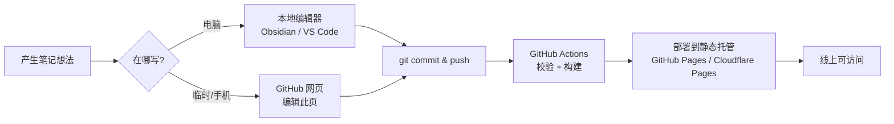
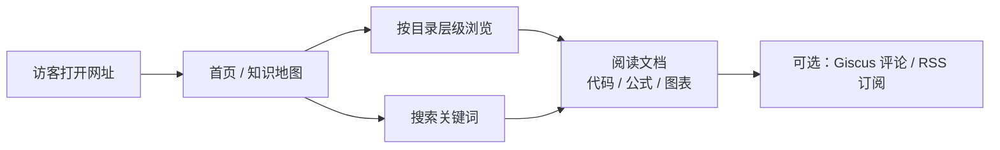
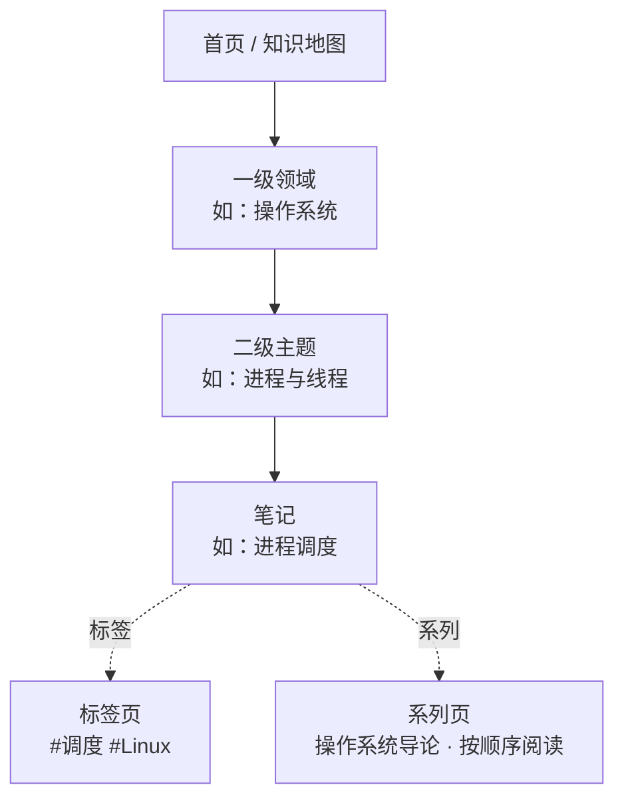
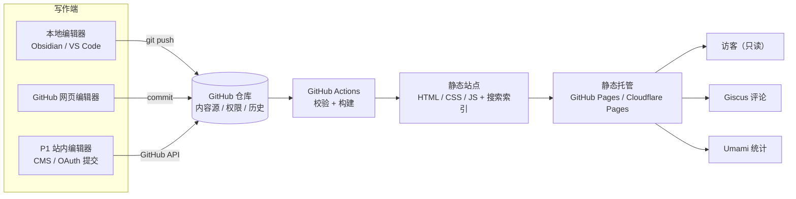

# 个人计算机知识库网站 · 需求文档

| 项目 | 内容 |
| --- | --- |
| 文档版本 | v0.1（草案） |
| 日期 | 2026-10-30 |
| 状态 | 待评审：第 12 章的决策项确认后冻结为 v1.0 |
| 项目定位 | 以 GitHub 仓库为内容源、本人可写、访客只读的个人计算机知识库 |
| 已确认环境 | Windows + Node.js 24 + Git 2.54；pnpm 未安装（可用 `corepack enable` 启用） |

---

## 0. 一页纸摘要

**要做什么**：一个记录计算机学习过程的个人知识库网站。文档以 Markdown 存放在 GitHub 仓库，网站由仓库自动构建为静态站点；站长通过本地编辑器或 GitHub 网页写作，其他访客只能浏览。

**为什么这样设计**：把"写作、版本管理、发布、权限"交给最擅长的工具——Git 管版本与权限，GitHub Actions 管发布，网站只负责展示。因此不需要自建账号体系、数据库和后台，成本接近 0，内容天然可迁移、可备份。

**六条核心建议**：

1. **先静态、后动态**：v1.0 只做静态站，1–2 天可上线；站内在线编辑器列为 P1，确认真的需要再做。
2. **权限不写代码**：把 GitHub 仓库写权限作为唯一编辑入口，网站不提供任何写入接口，从架构上杜绝"别人能改我的文档"。
3. **先定内容结构**：目录即层级、front matter 即元数据、英文 slug 即稳定 URL，避免后期大迁移。
4. **为扩展留接口**：选支持 MDX/组件、内容集合的框架；搜索、评论、统计、AI 都按"插件式"增量接入。
5. **提前处理两个坑**：中文全文搜索（推荐 Pagefind）与中国大陆访问（自定义域名 / CDN / 镜像）。
6. **先决定公开程度**：内容全部公开 → GitHub Pages 免费；含私密草稿 → 私有仓库 + GitHub Pro 或 Cloudflare Pages。

**需求对应关系**：

| 你的需求 | 方案如何满足 |
| --- | --- |
| 1. 方便快捷地添加 / 编辑文档 | Markdown + 模板 + 本地编辑器 / GitHub 网页"编辑此页"；P1 可加站内 CMS |
| 2. 良好的文档层级关系 | 目录即层级（3–4 层）+ 自动侧边栏 / 面包屑 / TOC + 标签与系列横向关联 |
| 3. 只允许自己编辑、他人只读 | 网站是静态产物、无写接口；编辑权限 = GitHub 仓库写权限；CMS 也只对有写权限者开放 |
| 4. 良好的功能扩展性 | MDX / 组件 + 内容集合 + 单一配置 + 插件式集成；内容纯 Markdown，可迁移 |

**默认推荐方案**：Astro Starlight + GitHub Actions + GitHub Pages + Pagefind + Giscus；内容为 Markdown；编辑走本地编辑器 / GitHub 网页；后续按需增加 Sveltia CMS（或 Decap CMS）或自建 OAuth 后台。

**MVP 范围（5 个 P0）**：层级导航、Markdown 写作、中文搜索、只读权限、自动部署。

---

## 1. 背景与目标

### 1.1 背景

- 学习计算机知识的过程中，笔记分散在本地文件、编辑器、聊天记录里，缺少统一入口。
- 希望长期沉淀、公开分享，但不想维护服务器、数据库和账号系统。
- 希望"只有自己能改"，其他人只能看；同时希望以后能方便地加功能（题库、评论、统计、AI 检索等）。
- 已有 GitHub 账号，希望以 GitHub 为内容和发布中心。

### 1.2 产品目标

| 编号 | 目标 | 衡量方式 |
| --- | --- | --- |
| G1 | 记录顺手：新增一篇笔记的摩擦足够低 | 从"有想法"到"线上可访问"≤ 3 分钟 |
| G2 | 结构清晰：任意知识可被导航和检索到 | 任意文档 ≤ 3 次点击可达；中文搜索可用 |
| G3 | 权限可靠：只有站长能编辑 | 站点无写接口；访客无法通过任何站内入口修改内容 |
| G4 | 可扩展：加功能不推倒重来 | 新增内容类型/集成平均 ≤ 1 天；URL 与内容格式稳定 |
| G5 | 低成本可运维：一个人也能长期维护 | 现金成本 ≤ ¥120/年（含域名）；日常无需运维 |

### 1.3 非目标（v1.0 明确不做）

- 多用户注册、协作编辑、多作者权限体系。
- 站内所见即所得编辑器（列入 P1，按第 12 章 Q2 决定）。
- 移动端 App、私密付费内容、复杂访问统计后台。
- 评论审核系统（先用 Giscus 托管在 GitHub Discussions）。
- 文档多版本（v1.0 不做；确有需要再评估 Docusaurus 的版本化能力）。

### 1.4 成功指标

| 指标 | 目标 |
| --- | --- |
| 新建并发布一篇文档耗时 | ≤ 3 分钟（本地或 GitHub 网页） |
| 构建部署 | push 后 ≤ 3 分钟站点更新，成功率 ≥ 99% |
| 首屏性能 | 移动端 Lighthouse 性能 ≥ 90，LCP ≤ 2.5s（4G） |
| 中文搜索 | 常用术语（如"进程调度"）能命中相关笔记，结果排序合理 |
| 内容安全 | 全年零丢失；每次修改有 Git 记录可追溯 |
| 权限 | 访客在站内不存在任何写入入口或写接口 |

---

## 2. 用户与场景

### 2.1 角色定义

| 角色 | 说明 | 权限 |
| --- | --- | --- |
| 站长（唯一作者） | 本项目所有者，即 GitHub 仓库的所有者 | 浏览 + 新建/编辑/删除/移动文档 + 发布 + 管理站点 |
| 访客 | 任何拿到网址的人（含未登录用户） | 只读浏览、搜索、切换主题；可选评论（需 GitHub 登录） |
| 未来的协作者（暂不启用） | 后续可能邀请的朋友 | 预留为 GitHub 仓库 Collaborator；v1.0 不实现 |

### 2.2 用户故事

| 编号 | 作为… | 我想… | 以便… |
| --- | --- | --- | --- |
| US-01 | 站长 | 在学习时 1 分钟内新建一篇带模板的笔记并发布 | 不打断学习节奏 |
| US-02 | 站长 | 把笔记放到正确的目录、调整顺序 | 保持知识结构清晰 |
| US-03 | 站长 | 重命名/移动文档而不破坏已有链接 | 结构可以持续演进 |
| US-04 | 站长 | 别人只能看不能改 | 内容安全、无需操心后台 |
| US-05 | 访客 | 按目录浏览、搜索中文关键词、看代码和公式 | 高效找到需要的知识 |
| US-06 | 访客 | 在手机/平板上正常阅读 | 随时随地查看 |
| US-07 | 站长 | 在任意电脑甚至手机上快速改一段文字 | 不必总带开发环境 |
| US-08 | 站长 | 以后加题库、评论、AI 问答时不用重写站点 | 保护长期投入 |

### 2.3 核心流程：日常写作与发布



### 2.4 核心流程：访客阅读



---

## 3. 权限与安全（本项目最核心的约束）

### 3.1 权限矩阵

| 操作 | 站长 | 访客（未登录） | 其他 GitHub 用户 |
| --- | --- | --- | --- |
| 浏览、搜索、订阅 RSS | ✅ | ✅ | ✅ |
| 评论（Giscus，需登录 GitHub） | ✅ | ❌ | ✅ |
| 新建 / 编辑 / 删除文档 | ✅ | ❌ | ❌ |
| 修改站点配置、主题 | ✅ | ❌ | ❌ |
| 查看私密草稿（若启用） | ✅ | ❌ | ❌ |
| Fork 仓库副本（仓库公开时） | ✅ | ❌ | ✅（GitHub 机制，无法禁止） |

### 3.2 实现原则

| 编号 | 原则 | 说明 |
| --- | --- | --- |
| R1 | 单一内容源 | 内容只存在于 GitHub 仓库，网站产物不反向写回 |
| R2 | 站点只读 | 访客拿到的只是构建后的 HTML/CSS/JS，站点本身没有任何写接口、Token 或数据库 |
| R3 | 权限交给 GitHub | 能改内容的唯一前提是拥有仓库写权限；网站不重复实现账号与权限系统 |
| R4 | 草稿不泄露 | 若草稿需要保密，必须使用私有仓库；构建时过滤只能让草稿不上站，不能阻止其在公开仓库可见（见 3.6） |

### 3.3 为什么不需要自建账号体系

- 静态站没有服务端，天然不存在"访客提交修改"的通道；这比"写一套登录 + 权限校验"更安全，也更省维护。
- GitHub 已提供成熟的账号、2FA、仓库权限、操作审计和版本历史，直接复用。
- 站长的编辑动作发生在 **GitHub 仓库**（本地 git 或 GitHub 网页），而不是网站里；网站只是发布结果。

> 结论：v1.0 不实现任何登录、不保存任何用户数据，是满足"只有我能编辑"成本最低且最可靠的方案。

### 3.4 若要做站内编辑：安全模型（P1，可选）

如果后续希望在站内直接编辑（例如手机上），安全设计必须满足：

1. **身份**：使用 GitHub App（推荐，权限细、令牌短时）或 GitHub OAuth App 登录。
2. **鉴权**：服务端回调后校验 GitHub **数字 user id** 白名单（login 可改名，不能作为唯一依据），并复核该用户对仓库的 `permissions`（push/admin），不通过一律拒绝。
3. **令牌**：client secret / 私钥只放服务端环境变量；访问令牌不返回前端；会话使用加密的 HttpOnly Secure Cookie。
4. **提交**：服务端用令牌调用 GitHub Contents API 提交，提交信息带 `via: web-editor` 便于审计。
5. **防护**：OAuth `state` 防 CSRF、接口限流、仅允许写入指定目录与文件类型、提交前做 front matter 校验。
6. **失败关闭**：任何一步校验失败即拒绝，不提供"匿名可写"的降级路径。
7. **审核**：每次站内编辑生成独立 commit，可在 GitHub 一键回滚。

### 3.5 安全边界与提醒

- **公开仓库 ≈ 内容公开**：仓库设为 public 时，即使网站不构建草稿，草稿文件仍可在 GitHub 上被直接看到。不要在公开仓库提交密钥、隐私信息或未准备公开的笔记。
- **Pages 站点本身永远公开**：即使仓库是私有的，GitHub Pages 发布的站点仍是公网可访问的（GitHub 官方说明）。"私有仓库"只保护源码，不保护网站内容。
- **无法阻止转载**：公开内容可被他人 fork、复制；如有需要，用 LICENSE 明确授权范围（如内容 CC BY-NC-SA 4.0、代码 MIT）。
- **账号安全就是内容安全**：GitHub 开启 2FA，保管好恢复码；在 Actions workflow 中显式声明最小 `permissions`（部署任务仅授予 `pages: write`、`id-token: write`）。
- **依赖安全**：启用 Dependabot；锁定依赖版本；不在仓库中出现任何 PAT / secret。

### 3.6 私密内容方案对比（若 Q1 选择"部分内容不公开"）

| 方案 | 做法 | 成本 | 复杂度 | 适用 |
| --- | --- | --- | --- | --- |
| A. 公开仓库 + 全部公开 | 仓库 public，Pages 免费 | ¥0 | 低 | 内容都可公开（推荐默认） |
| B. 私有仓库 + GitHub Pages | 需 GitHub Pro / Team（公开仓库免费，私有仓库发布 Pages 需付费计划） | 约 $4/月起 | 低 | 想保留草稿私密性 |
| C. 私有仓库 + Cloudflare Pages | 免费档支持私有仓库构建；构建时过滤 `drafts/` | ¥0 | 中 | 想零成本 + 私密仓库（推荐用于有草稿私密需求时） |
| D. 双仓库分离 | 私有仓库写草稿，发布时同步到公开仓库 | ¥0 | 高 | 草稿多、发布流程可控 |
| E. 客户端加密 | 私密内容加密后发布 | ¥0 | 很高 | 不推荐，密钥与体验都难维护 |

> **草稿私密性要点**：公开仓库里的 `draft` 文件即使不参与构建，仍可通过 GitHub 文件页、Raw、API 和代码搜索看到。"不被构建" ≠ "私密"；要真正私密，只能用私有仓库并在构建时排除草稿目录。

---

## 4. 功能需求

优先级定义：**P0** = MVP 必须；**P1** = 第二阶段；**P2** = 后续增强。

### 4.1 内容创作（FR-C）

| 编号 | 需求 | 优先级 | 验收要点 |
| --- | --- | --- | --- |
| FR-C-01 | 支持 Markdown（GFM）与 MDX 写作 | P0 | 标题、列表、表格、任务列表、代码块、引用、图片正常渲染 |
| FR-C-02 | 统一的 front matter 元数据 | P0 | 字段规范见 6.4；缺失必填字段时构建失败并提示 |
| FR-C-03 | 新建文档入口 ≥ 2 种 | P0 | ①本地新建文件并 push；②页面"新建笔记"跳到 GitHub 新建文件页（带模板内容） |
| FR-C-04 | 每篇文档有"编辑此页"入口 | P0 | 点击跳转到 GitHub 对应文件的编辑页，链接路径与实际文件一致 |
| FR-C-05 | 内容模板 | P0 | 至少 2 个：学习笔记模板、算法题模板；新建时可直接套用 |
| FR-C-06 | 图片与附件 | P0 | 支持拖拽/粘贴插入图片，构建时自动压缩与懒加载；图片路径不失效 |
| FR-C-07 | 草稿状态 | P1 | `draft: true` 的文档不出现在导航、搜索和构建产物中（私密性另见 R4） |
| FR-C-08 | 自动更新时间 | P1 | 页面显示"最后更新"，来源为 Git 提交时间 |
| FR-C-09 | 内容校验 CI | P1 | 校验 front matter、标题重复、空文档、图片体积、外链可达性 |
| FR-C-10 | 批量导入/迁移 | P1 | 支持从 Obsidian/语雀/Notion 导出的 Markdown 批量落库 |
| FR-C-11 | 写作规范检查 | P2 | 命名、标点、标题层级、死链的自动提示 |
| FR-C-12 | 站内新建向导 | P2 | 表单填写标题/分类/标签后生成完整 Markdown 文件并提交（依赖 FR-E） |

### 4.2 层级与组织（FR-S）

| 编号 | 需求 | 优先级 | 验收要点 |
| --- | --- | --- | --- |
| FR-S-01 | 目录即层级 | P0 | 目录树自动映射为导航（建议最多 3–4 层） |
| FR-S-02 | 侧边栏导航 | P0 | 自动生成侧边栏，支持分组、当前页高亮、移动端抽屉 |
| FR-S-03 | 手动排序 | P0 | 用数字前缀或配置控制同级顺序，顺序稳定可预期 |
| FR-S-04 | 标签 / 系列 / 难度 | P1 | 标签页与系列页自动聚合；可在 front matter 维护 |
| FR-S-05 | 面包屑与上下篇 | P0 | 位置正确；上级可点击 |
| FR-S-06 | 页内目录（TOC） | P0 | 自动提取二三级标题，滚动高亮，可锚点跳转 |
| FR-S-07 | 移动/重命名不断链 | P0 | slug 保持稳定；旧链接若失效，有重定向或明确处理策略 |
| FR-S-08 | 首页知识地图 | P1 | 展示一级领域卡片、最近更新、快速入口 |
| FR-S-09 | 别名与重定向 | P2 | 支持 `aliases` 生成重定向页，兼容旧链接 |
| FR-S-10 | 双向链接 / 反向链接 | P2 | 支持 `[[笔记]]` 或标准链接的反链展示（需评估插件） |

### 4.3 阅读与检索（FR-R）

| 编号 | 需求 | 优先级 | 验收要点 |
| --- | --- | --- | --- |
| FR-R-01 | 响应式阅读 | P0 | 375px 手机到 2K 屏幕布局正常，无横向滚动 |
| FR-R-02 | 暗色 / 亮色主题 | P0 | 跟随系统 + 手动切换 + 记忆选择 |
| FR-R-03 | 代码高亮与复制 | P0 | 常见语言高亮；一键复制；可选行号与文件名 |
| FR-R-04 | 数学公式（KaTeX） | P1 | 行内与块级公式渲染正确，构建时不报错 |
| FR-R-05 | 图表（Mermaid） | P1 | 流程图/时序图正常渲染，移动端可缩放 |
| FR-R-06 | 全文搜索 | P0 | 中文分词可用；支持标题、正文、标签命中；高亮关键词 |
| FR-R-07 | 搜索体验 | P1 | `Ctrl/Cmd + K` 打开搜索；最近搜索；无结果引导 |
| FR-R-08 | 阅读辅助 | P1 | 阅读时间、更新时间、作者信息、上一篇/下一篇 |
| FR-R-09 | 图片查看 | P1 | 点击放大、查看原图、alt 文本可读 |
| FR-R-10 | SEO 与订阅 | P1 | sitemap、canonical、OG 卡片、RSS、结构化数据 |
| FR-R-11 | 404 与锚点 | P0 | 自定义 404 回首页；标题锚点稳定 |
| FR-R-12 | 可访问性 | P1 | 键盘可导航、对比度达标、语义化结构、`prefers-reduced-motion` |
| FR-R-13 | 打印 / 导出 PDF | P2 | 打印样式可读；可按需生成 PDF |
| FR-R-14 | PWA / 离线 | P2 | 可安装、离线阅读已缓存页面（可选） |

### 4.4 互动与传播（FR-I，均为 P1/P2）

| 编号 | 需求 | 优先级 | 验收要点 |
| --- | --- | --- | --- |
| FR-I-01 | 评论 | P1 | 基于 Giscus + GitHub Discussions；需 GitHub 登录；站长可管理 |
| FR-I-02 | 访问统计 | P1 | 接入 Umami/Plausible 等隐私友好统计，不采集个人敏感信息 |
| FR-I-03 | RSS 订阅 | P1 | 提供全站与分类 RSS，可被阅读器识别 |
| FR-I-04 | 分享 | P2 | 复制链接、分享到常见平台（不引入重型 SDK） |
| FR-I-05 | 反馈入口 | P2 | 每页"报告问题"跳转 GitHub Issue，模板自动带页面 URL |

### 4.5 运维与管理（FR-M）

| 编号 | 需求 | 优先级 | 验收要点 |
| --- | --- | --- | --- |
| FR-M-01 | 自动构建部署 | P0 | push 到 `main` 后 Actions 自动构建并部署到 Pages |
| FR-M-02 | 构建状态可见 | P0 | 站点/仓库显示最近部署状态；失败有邮件或通知 |
| FR-M-03 | 手动触发与回滚 | P1 | 支持手动重跑；回滚通过 revert commit 完成 |
| FR-M-04 | 备份 | P1 | GitHub 仓库即主备份；定期导出仓库镜像/zip 到本地或对象存储 |
| FR-M-05 | 依赖维护 | P1 | Dependabot 自动提 PR；锁定版本；季度升级 |
| FR-M-06 | 站点监控 | P2 | 可用性监测（UptimeRobot 等）+ 构建失败告警 |
| FR-M-07 | 搜索索引更新 | P0 | 构建时自动生成搜索索引，无需手工维护 |
| FR-M-08 | 配置集中管理 | P1 | 站点标题、导航、社交链接、统计 ID 等集中在单一配置文件 |

### 4.6 站内在线编辑模块（FR-E，P1，可选）

> 触发条件：第 12 章 Q2 确认"需要手机/任意浏览器编辑"。否则不实现。

| 编号 | 需求 | 优先级 | 验收要点 |
| --- | --- | --- | --- |
| FR-E-01 | 仅站长登录 | P1 | 仅站长 GitHub 账号可进入编辑后台，其他账号即使登录也只能看到 403 |
| FR-E-02 | Markdown 编辑器 | P1 | 支持编辑、预览、快捷键、粘贴图片 |
| FR-E-03 | 文档管理 | P1 | 新建、重命名、移动目录、删除；操作即生成 commit |
| FR-E-04 | 图片上传 | P1 | 上传到约定目录并自动插入 Markdown 链接 |
| FR-E-05 | 草稿与发布 | P1 | 可保存为草稿或直接发布；发布后触发 Actions |
| FR-E-06 | 操作审计 | P1 | 每次编辑有 commit 记录（作者、时间、摘要） |
| FR-E-07 | 失败提示 | P1 | 网络/权限/校验失败时有明确提示，不丢编辑内容 |

### 4.7 MVP 范围（v1.0）

**P0 功能 = MVP**：

1. 目录层级 + 侧边栏 + 面包屑 + 页内 TOC（FR-S-01/02/03/05/06）。
2. Markdown/MDX + front matter + 模板 + 图片（FR-C-01/02/05/06）。
3. 编辑入口：本地写作 + "编辑此页" + "新建笔记"跳转（FR-C-03/04）。
4. 阅读体验：响应式、暗色、代码高亮、KaTeX、Mermaid（FR-R-01/02/03/04/05）。
5. 中文全文搜索（FR-R-06）。
6. 只读权限（R1–R4）。
7. 自动构建部署（FR-M-01/02/07）。

---

## 5. 非功能需求（NFR）

| 编号 | 类别 | 要求 |
| --- | --- | --- |
| NFR-01 | 性能 | 移动端 Lighthouse ≥ 90；LCP ≤ 2.5s；首屏 JS（gzip）尽量 ≤ 150KB；搜索索引按需加载 |
| NFR-02 | 可扩展性 | 新增内容类型、页面、集成不改动既有内容与 URL；配置与主题分离 |
| NFR-03 | 可维护性 | 单一内容源；约定优于配置；构建时间 ≤ 3 分钟；关键脚本有文档 |
| NFR-04 | 安全 | 公开站无写接口；无密钥入库；依赖可审计；GitHub 2FA；Actions 最小权限 |
| NFR-05 | SEO | 语义化 HTML、sitemap、canonical、OG、RSS、结构化数据 |
| NFR-06 | 可访问性 | WCAG 2.1 AA 基础项：键盘操作、对比度、alt 文本、焦点可见 |
| NFR-07 | 兼容性 | Chrome/Edge/Safari/Firefox 最近两个大版本；iOS Safari 15+；Android Chrome |
| NFR-08 | 可用性 | 静态托管天然高可用；GitHub 故障时可切镜像；内容可离线恢复 |
| NFR-09 | 成本 | 现金成本 ≤ ¥120/年（含可选域名）或明确列出付费项 |
| NFR-10 | 数据主权 | 内容为纯 Markdown/图片，可随时迁往任何静态框架或托管平台 |

---

## 6. 信息架构与内容规范

### 6.1 层级模型

采用"**目录分层 + 标签横切 + 系列串线**"的混合模型：



建议一级领域（可调整）：

```
01 计算机基础      （组成原理、操作系统、网络、数据结构）
02 编程语言        （C/C++、Python、Java、Go、Rust、JavaScript）
03 算法与数据结构
04 系统与工程      （Linux、数据库、分布式、编译原理）
05 软件工程        （设计模式、架构、测试、Git）
06 人工智能        （机器学习、深度学习、LLM）
07 项目实战与复盘
99 杂项与索引
```

### 6.2 目录结构示例

```text
cs-notes/
├─ .github/workflows/deploy.yml      # 构建 + 部署
├─ docs/                              # 项目自身的文档（需求、写作规范）
├─ public/                            # 静态资源（头像、favicon、附件）
├─ src/
│  ├─ content/docs/                   # ← 知识库正文（Obsidian 可直接打开此目录）
│  │  ├─ index.mdx                    # 首页
│  │  ├─ 01-foundations/
│  │  │  ├─ index.md
│  │  │  ├─ operating-system/
│  │  │  │  ├─ index.md
│  │  │  │  ├─ process.md
│  │  │  │  └─ scheduling.md
│  │  │  └─ network/
│  │  └─ 02-programming/
│  ├─ assets/                         # 构建期处理的图片
│  ├─ components/                     # 自定义 MDX 组件
│  └─ styles/                         # 主题样式
├─ astro.config.mjs                   # 站点/导航/主题配置
├─ package.json
└─ README.md
```

> 目录名加 `01-`、`02-` 前缀用于零配置排序；代价是 URL 带数字前缀。若不接受，可改用配置里显式定义侧边栏顺序。

### 6.3 命名与 URL 规范

| 项目 | 规范 | 示例 |
| --- | --- | --- |
| 目录 | 英文小写 kebab-case，可加两位数字前缀 | `03-algorithms/` |
| 文件 | 英文小写 kebab-case，语义化 | `dynamic-programming.md` |
| 标题 | 中文，写在 front matter | `title: 动态规划入门` |
| URL | 由文件路径决定，稳定不变 | `/03-algorithms/dynamic-programming/` |
| 图片 | `assets/` 下按年份/主题分目录 | `assets/2026/os/scheduling.png` |
| 锚点 | 标题自动生成，中文可用 | `#为什么需要调度` |
| slug | 一经发布不再修改；确需修改则保留旧链接跳转 | `aliases: [old-path]` |

**规则**：文件名一旦发布就不要改；调整结构时用新文件 + `aliases`/重定向，保证外部链接不失效。

> 部署形态会影响路径：项目站 `https://<user>.github.io/<repo>/` 需要在框架中配置 base/public path；用户站或自定义域名则从根路径开始。建议最终用自定义域名，URL 最干净。

### 6.4 front matter 规范

```yaml
---
title: 进程调度              # 必填，页面标题
description: 调度算法与 Linux CFS 的取舍  # 必填，搜索结果与 OG 描述
date: 2026-10-30             # 首次创建日期
updated: 2026-11-02          # 可选，默认取 Git 提交时间
tags: [操作系统, 调度, Linux]  # 标签（横切检索）
series: 操作系统导论          # 可选，系列名
order: 30                    # 可选，系列内顺序
category: 操作系统            # 可选，一级分类（默认取目录）
level: 进阶                   # 可选：入门 / 进阶 / 深入
status: 已整理                # 可选：草稿 / 整理中 / 已整理
draft: false                 # 可选，true 时不发布
aliases: [cpu-scheduling]    # 可选，旧路径/别名
---
```

| 字段 | 类型 | 必填 | 说明 |
| --- | --- | --- | --- |
| `title` | string | ✅ | 中文标题 |
| `description` | string | ✅ | 一句话摘要（用于搜索、SEO、卡片） |
| `date` | date | ✅ | 创建日期 |
| `updated` | date | ❌ | 最后整理日期，缺省用 Git 时间 |
| `tags` | string[] | ❌ | 2–5 个，避免同义词泛滥 |
| `series` / `order` | string / number | ❌ | 系列文章与阅读顺序 |
| `category` | string | ❌ | 一级分类，默认由目录推断 |
| `level` / `status` | enum | ❌ | 难度与整理状态 |
| `draft` | boolean | ❌ | 草稿开关（私密性见 3.6） |
| `aliases` | string[] | ❌ | 旧链接、别名 |

> 如果用 Astro Starlight，可通过扩展 `docsSchema()` 校验以上字段；VitePress/Nextra 可用 zod 或构建脚本校验。

### 6.5 分类法设计

| 维度 | 回答的问题 | 实现 | 维护成本 |
| --- | --- | --- | --- |
| 目录 | "它属于哪一科？" | 文件夹层级 + 侧边栏 | 低 |
| 标签 | "它还和什么有关？" | front matter `tags` → 自动生成标签页 | 中（需控制词表） |
| 系列 | "应该按什么顺序学？" | `series` + `order` → 自动生成系列页 | 低 |
| 难度/状态 | "现在适合看吗？" | `level` / `status` 徽标与筛选 | 低 |
| 索引页（MOC） | "从哪里开始？" | 手写 `index.md`/知识地图，聚合链接 | 中 |

建议：**目录负责主干，标签只做辅助**，标签总数控制在 30–50 个以内，避免变成第二个混乱的目录。

### 6.6 模板示例

**学习笔记模板**

```markdown
---
title: 
description: 
tags: []
level: 入门
status: 整理中
date: YYYY-MM-DD
---

## 一句话结论
## 它解决什么问题
## 核心概念
## 原理与细节
## 示例 / 代码
## 常见误区
## 与其他知识的联系
## 参考资料
```

**算法题模板**

```markdown
---
title: 题目名称
description: 一句话概括思路
tags: [算法, 动态规划]
date: YYYY-MM-DD
source: https://...
difficulty: 中等
---

## 题意
## 思路
## 复杂度
## 代码
## 易错点
## 同类题
```

### 6.7 写作规范

- **原子化**：一篇笔记只讲一个主题；内容过长拆成"总览 + 子篇"。
- **先结论后展开**：每篇开头给"一句话结论"，方便快速回顾。
- **链接优先**：相关内容用站内链接串联，减少孤立文档。
- **图片压缩**：单图 ≤ 500KB，优先 WebP/AVIF；大图放附件并说明。
- **不追完美**：允许 `status: 整理中`，先发布再迭代。
- **规范文档化**：写作规范放在 `docs/写作规范.md`，新建笔记时引用。

---

## 7. 技术方案

### 7.1 总体架构



**核心思想**：GitHub 仓库是唯一事实来源；网站是可随时重建的产物。

### 7.2 三种实现形态

| 形态 | 组成 | 满足需求 | 工作量 | 成本 | 适用 |
| --- | --- | --- | --- | --- | --- |
| A. 纯静态文档站（推荐 v1.0） | 静态框架 + GitHub Actions + Pages | 记录、层级、只读、扩展性中等 | 1–3 天 | ¥0 | 先上线、以写作为主 |
| B. 静态站 + Git-based CMS | A + Sveltia/Decap CMS（PAT / OAuth 代理 / Turbo 托管认证） | 增加站内可视化编辑 | A + 0.5–2 天 | ¥0 | 手机/浏览器编辑需求强 |
| C. 全栈自建 | Next.js/Nuxt + Auth + GitHub API/数据库 | 完全可控、私密内容、复杂功能 | 5–10 天 | ¥0–50/月 | 以后要做产品化功能 |

**建议路径**：A →（确有需要）B →（要做私密/多用户/AI）C。不要一上来做 C。

### 7.3 框架选型对比

| 维度 | Astro Starlight | VitePress | Next.js + Nextra 4 | Docusaurus 3 | MkDocs Material | docsify |
| --- | --- | --- | --- | --- | --- | --- |
| 技术栈 | Astro / MDX | Vue / Vite | React / Next.js | React | Python | 浏览器端 |
| 文档层级导航 | ✅ 强 | ✅ 强 | ✅ 强 | ✅ 强 | ✅ 强 | ⚠️ 一般 |
| 内置搜索 | ✅ Pagefind（中文分词较好） | ⚠️ 中文分词弱，建议 Pagefind 插件 | ✅ 内置搜索 | ⚠️ 需接 Algolia / 插件 | ✅ | ⚠️ |
| 组件扩展 | ✅ MDX + React/Vue/Svelte | ✅ Vue 组件 | ✅ React 生态最强 | ✅ React 插件多 | ⚠️ 前端扩展弱 | ❌ |
| 构建速度 / 产物 | 快 / 轻 | 很快 / 很轻 | 较慢 / 中等 | 慢 / 较重 | 快 / 轻 | 无需构建 |
| GitHub Pages 部署 | ✅ 简单 | ✅ 简单 | ✅ 静态导出可行 | ✅ | ✅ | ✅ |
| 未来接后台/API | ⚠️ 需另配 | ⚠️ 需另配 | ✅ 最自然 | ⚠️ | ❌ | ❌ |
| SEO | ✅ | ✅ | ✅ | ✅ | ✅ | ❌ 运行时渲染 |
| 学习成本 | 中 | 低（会 Vue 更低） | 中高 | 中 | 低 | 低 |
| 综合推荐度 | ★★★★★ | ★★★★☆ | ★★★★☆ | ★★★☆ | ★★★ | ★★ |

> 说明：GitHub Pages 只托管静态文件，以上框架除 docsify 外都需要在 Actions 中构建后部署。

### 7.4 推荐结论

**默认推荐：Astro Starlight**

理由：

- 静态输出、产物体积小、部署 GitHub Pages 简单，符合"只读 + 快"。
- 内置 Pagefind 全文搜索，且 Pagefind 对中文支持分词（无需额外服务），适合中文笔记。
- 侧边栏/目录/TOC/i18n/主题都是现成的，层级关系表达能力好。
- 支持 MDX 与 React/Vue/Svelte 组件，后续加"提示块、步骤条、题库、图表"扩展方便。
- 内容以集合（Content Collections）管理，未来增加"项目/题库/读书笔记"等类型时改动可控。

**分场景备选**：

- 只想最快上线、熟悉 Vue → **VitePress**（需要额外解决中文搜索，可用 Pagefind 插件或 Algolia）。
- 明确未来要在站内做后台/登录/API、熟悉 React → **Next.js + Nextra 4**（静态导出部署 Pages，未来可平滑切到 Vercel/Cloudflare 全栈）。
- 需要文档多版本（如教程 1.0/2.0）→ **Docusaurus**（版本化是它的强项，但更重）。
- 不推荐 docsify（SEO 与扩展性弱）、MkDocs（Python 工具链、前端扩展弱）作为本项目主方案。

### 7.5 在线编辑方案对比（P1 用）

| 方案 | 原理 | 成本 | 工作量 | 优点 | 风险/限制 |
| --- | --- | --- | --- | --- | --- |
| 纯 GitHub 网页编辑 | 每页链接到 GitHub 编辑/新建页 | ¥0 | 0.5 天 | 零后端、最安全 | 移动端体验一般；无站内富文本 |
| **Sveltia CMS（推荐 P1）** | 静态 `/admin` 页面，直接读写 GitHub 仓库；官方提供 Astro Starlight、VitePress 指南 | ¥0（MIT 开源） | 1–2 天 | 现代 UI、手机/平板友好、无数据库；可用细粒度 PAT 零后端登录 | ①PAT 登录时令牌存在浏览器本地存储，需用细粒度 token（仅该仓库 Contents 读写、可随时撤销）；②更安全的 OAuth 流程需部署 Cloudflare Workers 上的 Sveltia CMS Authenticator；③只有仓库写权限者可登录 |
| **Decap CMS + Turbo（推荐 P1）** | 静态 `/admin` 页面 + GitHub 后端提交 commit；Turbo 提供托管认证 | 开源免费；Turbo Free：€0（1 站 1 席），Pro €19/月 | 0.5–2 天 | 老牌开源（3.17.x，2026-10 仍更新）；Turbo 免去自建 OAuth 代理；有 VitePress 指南 | 仅仓库写权限者可用；自建 OAuth 代理需额外维护；界面较传统；Turbo 依赖第三方服务 |
| Keystatic | GitHub App + 管理界面 | ¥0 | 1–2 天 | UI 现代、类型安全、支持 Astro/Next | 仍为 0.x；GitHub 模式部署需要 Node.js 运行时，不能只放 GitHub Pages；admin 需单独托管 |
| 自建 OAuth 后台 | 自写 Next.js/Worker + GitHub API | ¥0–免费额度 | 3–5 天 | 完全可控、可加预览/审核/批量操作 | 安全责任最大；要维护登录、会话、限流、审计 |
| TinaCMS（商业） | TinaCloud + GitHub | Free（2 用户、100GB/月）或 $24/项目/月起 | 1–2 天 | 实时预览、协作 | 依赖第三方云；自托管要自跑 GraphQL/数据库/Auth.js |

**手机/平板编辑的过渡办法**（不写后端）：

- GitHub 手机 App 或手机浏览器打开仓库文件，可直接做小段文字修改并提交。
- GitHub Codespaces 提供浏览器内的完整 VS Code 环境，Free 账号每月有 120 core-hours + 15GB 存储的免费额度（以最新计费口径为准），适合 iPad/临时电脑，手机操作仍不方便。
- 站点每页的"编辑此页"链接到 GitHub，手机上也能完成"改一句 → 提交 → Actions 发布"。

**建议**：v1.0 只用"编辑此页 + GitHub 网页"；若需要手机/浏览器站内编辑，P1 有两个候选——**Sveltia CMS**（现代 UI、手机友好；细粒度 PAT 零后端起步，或部署 OAuth Worker）与 **Decap CMS + Decap Turbo Free**（托管认证、配置最少，免费 1 站 1 席）。两者都保持纯静态；只有需要私密内容、多用户或复杂后台时才自建。

> `?filename=` / `?value=` 预填在 2025 年的社区实践中可用，但 GitHub 官方文档未记载（属未公开行为）。实现前先做一次冒烟测试；若不生效，降级为站内"新建向导"生成 Markdown 后复制/下载，再粘贴到 GitHub 编辑器。这不影响 P0 验收（本地新建仍可用）。

### 7.6 中文全文搜索方案

| 方案 | 说明 | 成本 | 中文效果 | 推荐度 |
| --- | --- | --- | --- | --- |
| Pagefind | 构建时生成静态索引；中文分词在 extended 构建中支持（`npx pagefind` 默认即 extended，无词干、支持引号短语） | ¥0 | 较好 | ★★★★★ |
| VitePress 本地搜索 | 基于 MiniSearch，中文分词需自定义 tokenizer，否则召回差 | ¥0 | 一般（需调优） | ★★★ |
| Algolia DocSearch | 托管搜索；免费面向公开的技术文档/技术博客（不要求开源），需审核 | 免费（需审核） | 好 | ★★★（个人技术笔记可申请） |
| Meilisearch / Typesense 自建 | 独立搜索服务 | 需服务器 | 好 | ★★（重） |
| 浏览器全文遍历 | 构建时输出 JSON 前端过滤 | ¥0 | 差（大站点慢） | ★ |

**结论**：首选 Pagefind（Starlight 默认内置）；页面务必设置 `<html lang="zh-CN">`，否则中文索引/分词不生效。如果最终选 VitePress，优先用 Pagefind 插件而不是默认 MiniSearch（VitePress 2.0 alpha 已改进分词，但仍是 alpha）。

### 7.7 部署与国内访问

| 方案 | 说明 | 成本 | 大陆访问（参考） | 复杂度 |
| --- | --- | --- | --- | --- |
| GitHub Pages + 自定义域名 | 最省事；Actions 构建产物发布到 Pages | ¥0 + 域名费 | **差**：`*.github.io` 易被 SNI 干扰/连接重置；自定义域名可缓解但不保证 | 低 |
| Cloudflare Pages（免费档） | 连接 GitHub 自动构建；**官方支持私有仓库** | ¥0 | **中**：免费套餐在中国大陆无节点，仍走境外链路，但通常比 `github.io` 稳定 | 低 |
| Netlify / Vercel 免费档 | 免费额度部署；预览环境方便 | ¥0 | **不稳定**：Netlify 默认域名可访问但慢/抖动；Vercel 与 `*.pages.dev` 需按目标运营商自测 | 低 |
| Cloudflare 免费 CDN 代理 | 域名解析走 Cloudflare 缓存 | ¥0 | **有限**：免费套餐无大陆节点；Cloudflare 中国网络需 Enterprise + 已备案域名 | 中 |
| 大陆节点 + 备案域名 | 阿里云 OSS/CDN、腾讯云 EdgeOne 等，CI 同步产物 | 低（按量） | **最好**：需 ICP 备案；境外托管不强制 ICP，但合规以最新规定为准 | 高 |

> 前提：GitHub Pages / Cloudflare Pages 只托管静态文件，不支持服务端语言；动态能力（登录、AI 问答）需要额外的无服务器/边缘函数。

**建议**：

1. **低成本起步**：GitHub Pages + 自定义域名，观察实际访问情况。
2. **大陆访问是硬需求**：直接用 **Cloudflare Pages（私有仓库免费）+ 自定义域名** 作为主托管，GitHub 仍为唯一内容源。
3. **要求稳定的大陆体验**：备案域名 + 国内对象存储/CDN 做镜像，CI 双部署；GitHub 仓库始终是源。
4. 不要把 `*.github.io` 当作唯一入口——部分运营商会被重置；自定义域名是必选项（若在意大陆读者）。
5. 合规提醒：解析到大陆节点必须 ICP 备案；境外托管无需 ICP，但是否需要其他备案/合规手续请以最新规定自行核实。

### 7.8 成本估算

| 项目 | 方案 | 成本 |
| --- | --- | --- |
| 托管 | GitHub Pages（公开仓库） | ¥0 |
| CI/CD | GitHub Actions（公开仓库标准 runner 免费；私有仓库 Free 账户含月度计算额度） | ¥0 |
| 搜索 | Pagefind / 本地索引 | ¥0 |
| 评论 | Giscus | ¥0 |
| 统计 | Umami Cloud 免费档或自托管 | ¥0 |
| 域名（可选） | `.com`/`.dev` 等 | ≈ ¥60–120/年 |
| 私有仓库发布 Pages（可选） | GitHub Pro | ≈ $4/月 |
| 站内在线编辑（可选） | Sveltia CMS（MIT）；或 Decap Turbo Free（1 站 1 席） | ¥0 |

**结论**：纯公开方案年度现金成本可控制在 ¥0–120（主要是域名）。

> 说明：私有仓库 + Actions 在 Free 账户下含月度计算额度与存储（2026-10 官方口径为 $12/月计算额度 + 500MB 存储，以最新计费页为准）。

### 7.9 本地环境建议

- 当前机器：Node.js v24、Git 2.54 已就绪；pnpm 未安装，可执行 `corepack enable` 后使用 `pnpm`，或直接用 `npm`。
- 编辑器：VS Code（+ Markdown 插件）或 Obsidian（把 `src/content/docs` 当 vault 打开）。
- 本地预览：`npm run dev`；构建验证：`npm run build && npm run preview`。
- 提交前：跑一次内容校验脚本，避免 CI 才报错。
- GitHub Pages 部署推荐官方 workflow：`actions/configure-pages@v5` → `actions/upload-pages-artifact@v4` → `actions/deploy-pages@v4`，权限声明 `pages: write`、`id-token: write`。

---

## 8. 扩展性设计

### 8.1 扩展点模型

| 层 | 扩展方式 | 示例 |
| --- | --- | --- |
| 内容层 | Content Collections + schema | 新增 `problems`（题库）、`projects`（项目）、`reading`（读书笔记）类型 |
| 展示层 | MDX 组件注册表 | `Callout`、`Steps`、`Tabs`、`Quiz`、`CodeCompare` |
| 主题层 | CSS 变量 / 主题配置 | 换配色、字体、首页布局 |
| 配置层 | 单一 `site.config.ts` | 导航、社交链接、统计、功能开关 |
| 构建层 | 独立脚本 | 校验、图片优化、RSS、搜索索引、PDF 导出 |
| 集成层 | 静态嵌入或边缘函数 | 评论、统计、AI 问答、订阅 |

### 8.2 设计原则

1. **内容与展示分离**：Markdown + front matter 不依赖具体框架，换框架可迁移。
2. **约定优于配置**：目录→路由、front matter→元数据，减少手工维护。
3. **URL 稳定契约**：发布后的 slug 不变；结构变化用别名/重定向。
4. **集成即插即用**：评论/统计/AI 都以独立脚本或组件接入，能一键关闭。
5. **单一配置源**：导航与集成配置集中，避免散落。
6. **不过度设计**：v1.0 不引入数据库、登录、状态管理；确有需求再演进。

### 8.3 功能路线图（扩展候选）

| 功能 | 所需扩展点 | 预估 |
| --- | --- | --- |
| 题库 / 刷题记录 | 新内容类型 + 交互岛屿 + localStorage/后端进度 | P2 |
| AI 问答（RAG） | 构建时向量化 + 边缘函数（Cloudflare Workers AI / 外部 API） | P2 |
| 双向链接 / 知识图谱 | Markdown 链接解析 + 反链索引 | P2 |
| 系列课程 / 学习路径 | `series` + 顺序页 + 进度记录 | P1 |
| 版本化文档 | 框架选择变化（Docusaurus 或自定义目录） | P2 |
| 多语言 | Starlight i18n / VitePress locales | P2 |
| PWA / 离线 | Service Worker 插件 | P2 |
| 内容导出 PDF/EPUB | 构建脚本 | P2 |
| 私密笔记 | 私有仓库 + 鉴权（形态 C） | 按需 |
| 邮件订阅 | RSS→邮件服务（Buttondown 等） | P2 |

### 8.4 明确避免的设计

- ❌ 在公开静态站里放任何可写 API 或 PAT。
- ❌ 为"以后可能要"提前引入数据库/账号系统。
- ❌ 把内容格式绑定到某个平台的私有格式（如专用富文本 JSON）。
- ❌ 追求完美结构而迟迟不开始写内容。

---

## 9. 里程碑与工作量

| 阶段 | 内容 | 产出 | 预估 |
| --- | --- | --- | --- |
| M0 需求确认 | 本文档评审，确认第 12 章决策 | v1.0 需求（冻结） | 0.5 天 |
| M1 骨架上线 | 建仓库、初始化框架、示例页、Actions、Pages | 可访问的空站 + 自动部署 | 0.5–1 天 |
| M2 内容体系 | 目录、侧边栏、模板、front matter、搜索、暗色、代码/公式 | 可持续写作的完整站点 | 1–2 天 |
| M3 写作效率 | "编辑此页/新建笔记"链接、图片流程、内容校验 CI | 写作→发布闭环 | 0.5–1 天 |
| M4 体验增强 | Giscus 评论、RSS、统计、SEO、404、自定义域名 | 对外可用的知识库 | 1 天 |
| M5 在线编辑（可选） | Sveltia CMS / Decap CMS（含 Turbo）或自建 OAuth 后台 | 手机/浏览器编辑 | 0.5–5 天 |
| M6 扩展（持续） | 题库、AI 问答、双链、多语言等 | 按需 | 持续 |

> 总计：v1.0（M1–M4）约 3–5 个工作日；有前端经验可压缩到 2 天。

---

## 10. 验收标准

| 编号 | 验收标准 |
| --- | --- |
| AC-01 | 站长从"新建"到线上可见一篇新文档 ≤ 3 分钟，且无需手动部署 |
| AC-02 | 每篇文档都有"编辑此页"，点击能打开 GitHub 对应文件 |
| AC-03 | 目录结构变化后侧边栏/面包屑/上下篇自动正确更新 |
| AC-04 | 访客在站内找不到任何写入入口；浏览器的网络请求中不存在写接口 |
| AC-05 | 搜索"进程调度"等中文词能命中相关文档，结果有高亮与摘要 |
| AC-06 | 375px 宽度下无横向滚动，导航可用，代码块可横向滚动 |
| AC-07 | push 后 Actions 成功并在 3 分钟内更新站点；失败时有明确错误信息 |
| AC-08 | front matter 缺字段/格式错误时 CI 失败并指出具体字段 |
| AC-09 | 任意文档 ≤ 3 次点击可达；面包屑路径正确 |
| AC-10 | 移动端 Lighthouse 性能、可访问性、最佳实践、SEO 均 ≥ 90 |
| AC-11 | 自定义域名启用 HTTPS，旧 `github.io` 域名可访问或跳转 |
| AC-12 | 内容可完整克隆；每次修改在 Git 历史中可追溯、可回滚 |
| AC-13 | 图片经压缩、懒加载，页面无明显布局抖动（CLS < 0.1） |
| AC-14 | 关闭 JavaScript 时正文仍可阅读（静态 HTML 输出） |

---

## 11. 风险与对策

| 风险 | 影响 | 概率 | 对策 |
| --- | --- | --- | --- |
| GitHub Pages 在中国大陆访问不稳定 | 读者打不开或很慢 | 高 | 自定义域名；改用 Cloudflare Pages；必要时国内镜像 |
| 公开仓库导致草稿/隐私泄露 | 内容事故 | 中 | 私密内容用私有仓库；提交前检查；公开仓库不放敏感信息 |
| 图片/附件体积膨胀 | 构建慢、流量超限 | 中 | 构建时压缩、懒加载、单图限额、定期清理 |
| 中文搜索效果不佳 | 找不到内容 | 中 | 首选 Pagefind；不满意再换 Algolia/Meilisearch |
| 文档移动导致链接失效 | 外部链接 404 | 中 | slug 稳定 + `aliases` + CI 死链检查 |
| 单人维护、依赖升级 | 站点长期失修 | 中 | 锁定版本、Dependabot、季度升级、最小依赖 |
| GitHub 账号或仓库异常 | 无法发布/内容丢失 | 低 | 2FA、恢复码、定期镜像备份、多平台托管 |
| 加了站内编辑后台后的安全漏洞 | 内容被篡改 | 低 | OAuth + owner 校验 + 最小权限 + 审计；能不做就不做 |
| 内容被转载/抄袭 | 版权问题 | 中 | LICENSE 明确授权；如水印/引用规范 |
| 框架升级破坏构建 | 站点停更 | 低 | 内容 Markdown 可迁移；保留可回滚 tag |

---

## 12. 待确认问题（决策清单）

| 编号 | 问题 | 影响 | 建议默认 |
| --- | --- | --- | --- |
| Q1 | 内容是否全部公开？仓库用 public 还是 private？ | Pages 套餐、成本、草稿私密性 | 先 public（免费、简单），私密内容另用私有仓库 |
| Q2 | 是否必须站内在线编辑（手机/任意浏览器）？还是本地/GitHub 网页即可？ | 是否做 P1 后台、工作量 +1–5 天 | v1.0 先不做，保留 GitHub 网页编辑 |
| Q3 | 技术栈偏好（React / Vue / 无偏好）？ | 框架选择 | 无偏好 → Astro Starlight |
| Q4 | 是否需要评论、访问统计、自定义域名？ | 集成与成本 | 评论 + 统计要；域名可选 |
| Q5 | 现有笔记规模与来源（Obsidian/语雀/Notion/散落文件）？ | 迁移方案与工作量 | 先抽样迁移，再批量 |
| Q6 | 预估内容量（篇数、图片量）？ | 性能与图片策略 | 按 1–3 年 300 篇设计 |
| Q7 | 预算（必须 ¥0 / 可接受域名费 / 可接受月费）？ | 托管与工具选型 | ¥0–120/年 |
| Q8 | 大陆访问速度优先级？ | 部署拓扑 | 中：先 GitHub Pages + 域名，观察后再优化 |

---

## 附录 A：候选技术速查

| 框架 | 官网 | 一句话 |
| --- | --- | --- |
| Astro Starlight | https://starlight.astro.build/ | 静态文档站首选：快、内置搜索、MDX 组件 |
| VitePress | https://vitepress.dev/ | Vue 系轻量文档站，上手最快 |
| Nextra 4 | https://nextra.site/ | Next.js 上的文档站，React 全栈扩展最自然 |
| Docusaurus 3 | https://docusaurus.io/ | 功能全、插件多、支持版本化，偏重 |
| MkDocs Material | https://squidfunk.github.io/mkdocs-material/ | Python 生态、Markdown 友好，前端扩展弱 |
| docsify | https://docsify.js.org/ | 运行时渲染，SEO/扩展性弱，不推荐 |

## 附录 B：参考链接

- GitHub Pages 限制（1GB、100GB/月软限制、构建 10 分钟超时等）：https://docs.github.com/en/pages/getting-started-with-github-pages/github-pages-limits
- GitHub Pages 创建与权限（公开仓库免费；私有仓库需付费计划）：https://docs.github.com/en/pages/getting-started-with-github-pages/creating-a-github-pages-site
- GitHub Pages 自定义 Actions 工作流（不受 10 次/小时软限制）：https://docs.github.com/en/pages/getting-started-with-github-pages/using-custom-workflows-with-github-pages
- GitHub Actions 计费（公开仓库标准 runner 免费；私有仓库按包含额度计费）：https://docs.github.com/en/billing/concepts/product-billing/github-actions
- Cloudflare Pages 限制（Free 档构建次数、文件数等）：https://developers.cloudflare.com/pages/platform/limits/
- Pagefind 多语言/中文分词说明：https://pagefind.app/docs/multilingual/
- Astro Starlight 站点搜索（默认 Pagefind）：https://starlight.astro.build/guides/site-search/
- Nextra 静态导出：https://nextra.site/docs/guide/static-exports
- Keystatic GitHub 模式（需 Node.js 运行时）：https://keystatic.com/docs/github-mode
- Sveltia CMS（Git-based CMS，Decap 的现代替代）：https://sveltiacms.app/en/docs/frameworks/starlight
- Sveltia CMS GitHub 后端与认证方式：https://sveltiacms.app/en/docs/backends/github
- Sveltia CMS Authenticator（Cloudflare Workers OAuth 客户端）：https://github.com/sveltia/sveltia-cms-auth
- Decap CMS：https://decapcms.org/
- Decap CMS 版本与更新（3.17.x）：https://decapcms.org/docs/releases/
- Decap Turbo（托管认证，免费档 1 站 1 席）：https://decapcms.org/turbo/
- VitePress 搜索配置：https://vitepress.dev/reference/default-theme-search
- Algolia DocSearch 申请资格：https://docsearch.algolia.com/docs/who-can-apply/
- TinaCMS 定价：https://tina.io/pricing
- GitHub Actions 包含额度：https://docs.github.com/en/billing/reference/product-usage-included
- Giscus：https://giscus.app/
- GitHub OAuth Apps：https://docs.github.com/en/apps/oauth-apps
- GitHub Apps：https://docs.github.com/en/apps
- GitHub Contents API：https://docs.github.com/en/rest/repos/contents

## 修订记录

| 版本 | 日期 | 说明 |
| --- | --- | --- |
| v0.1 | 2026-10-30 | 初稿：需求、权限、内容规范、技术方案与里程碑 |
