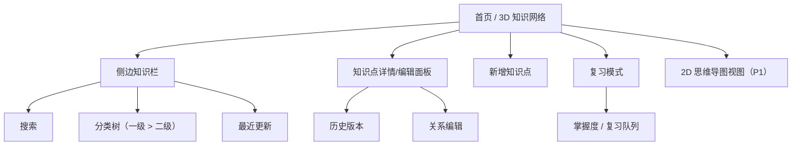
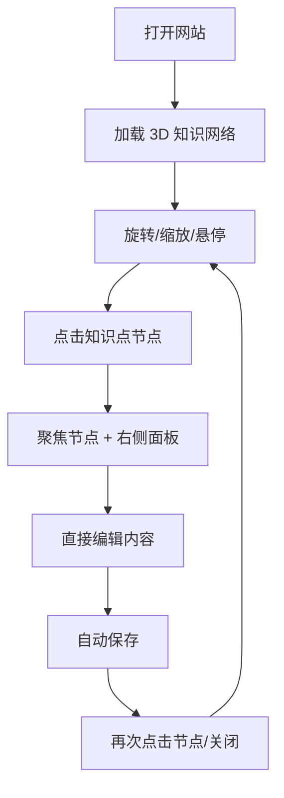

# 个人学习知识网络 · 需求文档

| 项目 | 内容 |
| --- | --- |
| 文档版本 | v0.2（需求细化稿） |
| 日期 | 2026-10-30 |
| 状态 | 根据 2026-10-30 需求访谈回答重写；确认第 13 章问题后冻结为 v1.0 |
| 交互原型 | `prototype/index.html`（v1.0：Obsidian Light 白底紫调；默认空工作区；知识点独立标签页、一级分类下直接放文件；双链/反链/命令面板；Markdown 源码实时预览 + vault 导入导出；本地可编辑、线上只读发布；假数据/发布快照、本机 localStorage；双击即可打开） |
| 设计探索 | `prototype/designs/index.html`（6 个工具化视觉方向，可直接打开 `index.html?design=1…6`） |
| 留白重构 | `prototype/designs/round2.html`（07 Air / 08 Quiet；最终选定 08 Quiet） |
| 产品代号 | 暂定「知识星图 / Knowledge Nebula」（可改） |
| 一句话 | 一个只属于我的、可探索的 3D 知识网络，用来记录计算机学习中的知识点，并帮助我记忆、复习、查询、巩固。 |
| 已确认约束 | 单人使用；¥0 预算；内容可私有；桌面为主、少量手机；秒级自动保存；同一时间单设备编辑；当前为一级分类（分类下直接放文件，2026-10-30 调整）；所见即所得；愿意维护自己的代码；版本管理是硬需求 |

> v0.1 草稿（文档站 + GitHub Pages + 在线 CMS 方向）已归档到 `docs/archive/需求文档-v0.1.md`，仅作历史参考，不再作为实现依据。

> **2026-10-30 交互修订（v1.0 原型）**：分类简化为「一级分类 → 知识点文件」，树可自由展开/收起、分类可删除；左侧分类栏可整体向左收起，分类树与主面板各自独立上下滚动；3D 图内滚轮只缩放图、图外滚轮才滚主面板，两者不冲突；点击知识点进入独立页面（hash 路由），不再使用抽屉；新建直接落空白文件（未选中一级分类时新建一级分类）；删除掌握度与复习；星图、最近更新、数据概览均为 1.618:1 黄金比例卡片；星图节点改为带名称的圆形节点，分类间有主干连线，新分类自动接入；连线加强并带星云背景；星图每帧驱动相机自动旋转、节点悬停无缩放动画、圆形节点层不拦截拖拽（从节点上也能旋转图），图外鼠标操作不影响旋转，不随树点击过滤，新增/删除文件时更新。版本历史已做本地快照与恢复（每个知识点最多 40 个），底部菜单支持导出/导入 JSON 备份。功能参考 Obsidian：工作区改为「左侧功能条 + 文件树 / 中间标签页 + 编辑器/图谱 / 右侧大纲与反向链接 / 底部状态栏」的 Obsidian 式布局，采用 **Obsidian Light 白底紫调**主题，打开网站默认显示无标签空工作区；图谱和数据卡使用弹性布局（宽屏图左/数据右，窄屏全宽下移，手机单列），左侧文件树提供常驻「知识网络」入口；WebGL 不可用时自动切换到 Canvas 2D 图谱，避免 3D 初始化失败导致空白；支持 Markdown 源码 + 实时预览（`Ctrl/Cmd+Shift+M`）以及 Markdown vault 导入/导出（分类文件夹、frontmatter、双链保留）；提供 PWA manifest/Service Worker（安装、离线）和 GitHub Pages Actions 部署；本地可编辑、GitHub Pages 自动只读，通过 `published-vault.js` 发布快照；支持 `[[双向链接]]`、反向链接/出链/大纲检查器、命令面板（Ctrl+P）、快速切换（Ctrl+O）、标签关闭（Ctrl+W）和阅读视图（Ctrl+E），双链自动映射为 3D 图连线。「知识网络」也是可关闭标签，可从 Ribbon 或空工作区重新打开；全部标签关闭时显示空工作区。当前为浏览器本地原型，编辑器是 Live Preview 风格富文本而非完整 Markdown 引擎，不是 Obsidian 插件，也不直接读取桌面 vault。本文其他章节如与本修订冲突，以本修订为准。

---

## 0. 一页纸摘要

### 0.1 核心体验

打开首页，看到一张**可旋转、可缩放、可点击的 3D 知识网络**；左侧是知识栏；点击一个知识点节点，右侧滑出**可直接编辑**的内容面板；改完自动保存；再次点击节点或关闭按钮，面板收起，继续在知识网络里探索。首页固定有「添加知识点」按钮，新增和修改都是自动保存。

### 0.2 关键设计判断

- **不是文档站/博客**：以「知识点」为节点、以「关系」为连线，而不是文件夹目录树。
- **不是后台管理工具**：没有「列表 → 表单 → 保存」的强流程；首页就是图谱，编辑发生在节点上。
- **单人自用**：不做多人协作、社区、评论、复杂权限；只在「编辑」这一层做登录保护。
- **0 预算**：所有依赖必须落在免费额度内，不购买服务器、数据库、域名（域名可选，不默认买）。
- **秒级体验**：前端乐观更新 + 后台自动保存；同一时间只在一台设备上编辑，因此不做复杂冲突合并。
- **2 级分类 + 知识点 + 关系 = 知识体系**：3D 网络用于探索和记忆，2D 思维导图用于俯瞰和导出（P1）。
- **像工具，但不等同于工具**：效率之外要有「探索感/美感/沉浸感」，具体风格待确认。

### 0.3 我对需求的理解（请检查）

1. 这是**个人学习系统**，不是公开产品；别人可看可不看，不影响核心设计。
2. 首页必须先看到 **3D 可交互知识网络**，其次有**侧边知识栏**、**最近更新**和**添加知识点**。
3. 基本单元是**知识点**；分类最多 **2 级**；知识点之间用**关系连线**组成网络/思维导图。
4. 点击节点 → 内容**直接可编辑**（所见即所得）→ 自动保存 → 再次点击收起。
5. 目的不只是「存」，还包括**记忆、复习、查询、巩固**。
6. **¥0 预算**，接受自己维护代码；GitHub 用于版本管理，但不强制 GitHub Pages。
7. **电脑为主、手机为辅**；手机端编辑程度待确认。

### 0.4 MVP 范围（P0）

3D 知识网络首页 + 侧边知识栏 + 知识点详情/编辑面板 + 所见即所得编辑 + 自动保存 + 新增知识点 + 2 级分类 + 搜索 + 最近更新 + 最小复习（掌握度 + 随机回顾）+ 登录保护 + 版本可追溯。

### 0.5 待确认（不阻塞本稿）

见第 13 章：复习机制强度、关系连线产生方式、网站公开范围、手机端编辑程度、视觉风格、版本历史呈现方式、技术路线偏好。

---

## 1. 背景、问题与目标

### 1.1 背景

- 学习计算机知识时，知识点零散，缺少体系；记录不方便，手机和电脑之间不连贯。
- 现有笔记工具要么偏文档目录（看不出知识之间的关系），要么偏通用工具（缺少探索感和记忆辅助）。
- 目标不是做一个公开博客，而是做一个**帮助自己记忆、复习、查询、巩固**的个人知识网络。

### 1.2 要解决的问题

| 编号 | 问题 | 表现 |
| --- | --- | --- |
| P1 | 知识无体系 | 学过的东西散落，不知道之间有什么关系 |
| P2 | 记录不方便 | 多一步操作就不想记；手机端尤其明显 |
| P3 | 查不到/想不起 | 知道学过，但搜不到、找不到关联 |
| P4 | 记不住 | 记录完就结束，没有复习和巩固机制 |
| P5 | 工具体验差 | 表格、列表、表单式工具缺少「探索知识」的感觉 |

### 1.3 产品目标

| 编号 | 目标 | 衡量方式 |
| --- | --- | --- |
| G1 | 记录顺手 | 首页 ≤ 3 次点击、≤ 10 秒新增一个知识点并保存 |
| G2 | 体系可见 | 任一知识点能在 3D 网络/侧栏/思维导图中找到位置 |
| G3 | 查询快 | 中文关键词能在 1 次搜索内定位到知识点并高亮节点 |
| G4 | 记忆与巩固 | 有掌握度标记和复习入口；能按计划回顾 |
| G5 | 体验感 | 首页是一个「想去点点看」的知识星空，而不是管理后台 |
| G6 | 数据可控 | 每次修改可追溯、可恢复、可导出；0 成本运行 |

### 1.4 非目标（v1 不做）

- 多人协作、账号体系、评论、社区、公开投稿。
- 公开博客/SEO 运营、RSS 订阅、广告。
- 手机端完整复杂编辑（待确认）。
- 复杂权限（只区分「站长」和「只读访客」）。
- 付费服务、自建服务器、数据库运维。
- 历史笔记导入（目前没有旧笔记）。

### 1.5 设计原则（体验层）

1. **首页即产品**：打开就是 3D 图谱，不把图谱藏在二级页面。
2. **点哪看哪、看哪改哪**：从节点到编辑不超过 1 次点击。
3. **没有保存按钮**：输入即存，状态可见；不打断心流。
4. **一眼体系**：分类颜色、聚类、关系线、选中高亮要能一眼看懂。
5. **探索感优先于炫技**：动画顺滑但不拖慢操作；性能不达标时降级，不卡顿。
6. **少弹窗、少表单**：新增知识点默认只强制标题，分类可后补。

---

## 2. 用户、访问与权限

### 2.1 角色

| 角色 | 说明 | 权限 |
| --- | --- | --- |
| 站长（唯一编辑者） | 本人 | 浏览、搜索、新增/编辑/删除知识点、管理分类与关系、复习、查看历史、导出 |
| 访客（可选） | 任何拿到网址的人（默认公开只读） | 浏览 3D 图与知识点内容、搜索；**不能编辑**；无任何写入口 |
| 未来协作者 | 暂不设计 | 不实现 |

### 2.2 访问模式（待确认，默认按 A 设计）

- **A（默认）**：网站公开只读，源码/内容存储可私有；任何人可看，只有站长登录后可编辑。
- **B**：网站本身需要登录才能看（仅自己或指定的人）。
- **C**：部分公开、部分私密（例如草稿和私人笔记不公开）。
- 无论哪种，**编辑权限只属于站长**。

### 2.3 认证与安全原则

- 编辑必须登录；登录方式优先 **GitHub OAuth**（免费、无需自建账号），备选单用户密码。
- 除站长外的用户即使登录也没有写权限；所有写操作服务端二次校验。
- 公开页面不包含任何可写 Token；富文本内容需做 XSS 清洗。
- GitHub 账号开启 2FA；会话可退出；建议提供「退出所有设备」。
- 内容存储私有（如 GitHub 私有仓库），公开站点只发布展示内容。

### 2.4 设备与使用场景

- **桌面为主**：完整编辑、图谱探索、复习。
- **手机为辅**：浏览、搜索、快速记一句、简单修改（完整编辑程度待确认）。
- 同一时间只在一台设备编辑；换设备时以服务端最新数据为准。

---

## 3. 核心概念与信息架构

### 3.1 核心概念

| 概念 | 定义 |
| --- | --- |
| 一级分类（Domain） | 知识领域，例如「计算机基础」「编程语言」「算法」「系统与工程」「AI」 |
| 二级主题（Topic） | 领域下的主题，例如「计算机基础 → 操作系统」；**分类最多 2 级** |
| 知识点（Knowledge Point） | 最小学习单元，拥有标题、富文本内容、图片、代码、公式、图、标签、关系、掌握度 |
| 关系（Relation） | 知识点之间的连线，例如「相关」「前置」「对比」「延伸」 |
| 掌握度（Mastery） | 陌生 / 模糊 / 熟悉 / 已掌握 |
| 复习（Review） | 按计划或随机抽取知识点进行回忆、自评、再次安排 |
| 版本（Revision） | 每次保存产生的可追溯快照（Git commit 或应用内版本记录） |

### 3.2 分类规则

- 一级分类数量建议 5–10 个；二级主题每个一级下 3–10 个。
- 每个知识点必须归属一个二级主题；可临时放入「Inbox（未分类）」。
- 分类支持新增、重命名、排序、删除（删除时知识点移到 Inbox 或指定分类）。
- 一级分类分配颜色，用于 3D 节点颜色和图例。

**示例目录（需求访谈中你预计为 2 级）：**

```text
计算机基础
├─ 操作系统
│  ├─ 进程与线程
│  ├─ 进程调度
│  └─ 内存管理
├─ 计算机网络
│  ├─ TCP/IP
│  └─ HTTP
└─ 数据结构
   ├─ 数组与链表
   └─ 树与图

编程语言
├─ C / C++
└─ Python

算法
├─ 排序
└─ 动态规划
```

> 注意：这里是「分类层级」；知识点本身是节点，可以跨主题建立关系连线。

### 3.3 知识点内容

- 标题（必填，1–100 字符）。
- 富文本正文：文字、列表、引用、链接、表格、代码块（高亮）、数学公式、Mermaid 图、图片。
- 可选：摘要、标签、来源链接、掌握度、关系、备注。
- 长度不固定：通常中等，偶尔很长；编辑器和保存机制不能明显变慢。

### 3.4 图谱数据呈现

- **节点**：知识点。
- **节点颜色**：一级分类。
- **聚类/布局**：二级主题形成视觉集群；支持按分类筛选。
- **连线**：
  - P0：同一二级主题的知识点之间自动弱连接（浅色），形成初始网络；分类关系通过聚类表达。
  - P1：手动建立知识点关系（相关/前置/对比/延伸），显示为不同颜色/样式。
  - 待确认：是否要自动按标签连线。
- **节点大小**：默认一致；可切换为按「关联数」或「掌握度」显示（P1）。
- **标签**：悬停或近景时显示标题（LOD），避免全量文字重叠。

### 3.5 首页布局

```text
┌──────────────────────────────────────────────────────────────────────┐
│ 顶部栏：品牌 / 搜索框          [ + 添加知识点 ]   [复习]  [视图切换]  │
├───────────────┬──────────────────────────────────────┬───────────────┤
│ 知识栏         │                                      │ 知识点详情/编辑 │
│ 🔍 搜索        │          3D 知识网络                  │  标题         │
│ ▾ 计算机基础   │       ●────●        ●                │  分类 / 标签   │
│   ▾ 操作系统   │        \  /       /                  │  富文本编辑器   │
│     · 进程调度 │         ●────●───●                   │  自动保存状态  │
│     · 内存管理 │                                      │  关系 / 掌握度  │
│ ▾ 编程语言     │        （鼠标拖拽旋转 / 滚轮缩放）      │  [历史] [删除] │
│ 最近更新       │                                      │  [收起]       │
│  · 进程调度    │                                      │               │
└───────────────┴──────────────────────────────────────┴───────────────┘
```

- 3D 图占满主要视野；侧栏和详情面板可收起。
- 点击节点 → 右侧面板滑出，图谱聚焦该节点；再次点击同一节点/关闭按钮/Esc 收起。
- 移动端：侧栏改为抽屉，详情面板全屏；3D 图支持触控，必要时降级为 2D/简版。

### 3.6 信息架构



---

## 4. 首页与核心交互

### 4.1 打开首页

1. 加载 3D 知识网络（有加载进度/骨架，失败可重试）。
2. 节点按一级分类着色、按二级主题聚类。
3. 顶部有搜索、添加、复习、视图切换；左侧知识栏展示分类树、最近更新。
4. 首次使用时展示简短引导（旋转/缩放/点击/添加），不强制教程。

### 4.2 3D 知识网络操作

| 操作 | 行为 |
| --- | --- |
| 鼠标拖拽 | 旋转视角 |
| 滚轮/触控板 | 缩放 |
| 右键拖拽/双指 | 平移 |
| 悬停节点 | 放大、显示标题摘要 |
| 单击节点 | 聚焦该节点、高亮邻居、打开右侧详情面板 |
| 再次单击同一节点 / Esc / 关闭 | 收起详情面板，恢复全局视角 |
| 单击空白 | 取消选中、收起面板 |
| 搜索/筛选 | 匹配节点高亮，其余降低透明度 |
| 添加按钮 | 打开新增知识点流程 |

### 4.3 知识点详情/编辑面板

- 从右侧滑出（桌面约 420–560px），覆盖部分图谱；图谱变暗但仍可见。
- 顶部：标题输入框（大字号）、分类选择、标签、更多操作。
- 正文：所见即所得编辑器（类似 Notion），点击文字即可输入。
- 底部/顶部状态：保存中 / 已保存 / 保存失败重试；最后更新时间。
- 操作：删除、历史版本、复制链接、收起。
- 关闭面板不丢内容（先 flush 自动保存）。

### 4.4 新增知识点

- 入口：首页顶部「＋ 添加知识点」、侧栏「＋」、快捷键 `N`。
- 流程：输入标题（必填）→ 选择一级/二级分类（默认上次使用或 Inbox）→ 创建并立即打开编辑面板。
- 标题确认后立即生成节点，自动保存；分类/标签可后补。
- 新节点在图中高亮定位，避免「创建后找不到」。

### 4.5 搜索与最近更新

- 搜索框常驻顶部或侧栏；支持中文子串。
- 搜索结果显示标题、分类、摘要片段；点击 → 聚焦节点并打开详情面板。
- 无结果时给出提示和「创建该知识点」快捷入口（P1）。
- 最近更新：按 `updatedAt` 倒序，显示标题、分类、时间；点击跳转。

### 4.6 复习模式（最小版 P0，完整版 P1）

**最小版（P0）**
- 给每个知识点标记掌握度：陌生 / 模糊 / 熟悉 / 已掌握。
- 「随机回顾」：从全部或某个分类中随机抽一个知识点，只显示标题和摘要 → 回忆 → 展开内容对照 → 自评并更新掌握度 → 下一个。

**完整版（P1）**
- 复习队列：根据掌握度和上次复习时间安排到期复习（简单间隔：1/3/7/15/30 天）。
- 复习统计：今日复习数、连续天数、掌握度分布。
- 可选的「闪卡/问答对」模式（P2）。

### 4.7 2D 思维导图（P1）

- 提供「3D 网络 / 2D 思维导图」视图切换。
- 2D 视图按「一级分类 → 二级主题 → 知识点」树状布局，便于俯瞰和打印/导出。
- 支持导出 PNG/SVG（P2）。
- 说明：3D 网络负责探索和记忆；2D 导图负责结构和输出。

### 4.8 版本历史（P1 界面，P0 数据可追溯）

- 数据层每次保存产生可追溯版本（Git commit 或应用内快照）。
- 面板内提供「历史」：按时间列出修改，可预览、恢复（恢复生成新版本）。
- 至少保证：误删/误改可以找回。

### 4.9 自动保存规则

- 输入停止约 800ms 后触发保存；切换节点/收起面板/刷新前强制 flush。
- 保存状态可见；失败自动重试（指数退避），并允许手动重试。
- 同一时间只在一台设备编辑，因此不实现复杂合并；检测到另一标签页编辑同一知识点时提示（P2）。
- 「秒级」定义：输入后 ≤1s UI 显示已保存状态；服务端确认 ≤3s（取决于后端方案）。

### 4.10 移动端

- 响应式布局：侧栏抽屉、详情面板全屏、顶部操作压缩。
- 3D 图支持单指旋转、双指缩放、点按选中；性能不足时切换 2D/简化模式。
- 手机编辑：至少支持改标题、短文本、分类；完整富文本编辑待确认。

### 4.11 视觉与体验

- 建议默认**暗色知识星空**风格：深色背景、分类色节点、柔光连线、平滑镜头聚焦；同时提供亮色主题（P1）。
- 动效：节点选中发光、镜头飞行、面板滑入；尊重 `prefers-reduced-motion`。
- 「像工具但不等同于工具」的具体含义待确认：探索感 / 美感 / 仪式感 / 游戏化，先按「沉浸式探索 + 高效」设计。

---

## 5. 功能需求

优先级：**P0** = v1 必须；**P1** = v1 后第一优先；**P2** = 以后可选。

### 5.1 视图与图谱（FR-G）

| 编号 | 需求 | 优先级 | 验收要点 |
| --- | --- | --- | --- |
| FR-G-01 | 首页首屏展示 3D 力导向知识网络 | P0 | 打开首页可见图，可旋转/缩放/平移 |
| FR-G-02 | 节点=知识点，颜色=一级分类 | P0 | 图例可对照；分类色一致 |
| FR-G-03 | 点击节点 → 聚焦 + 打开详情面板 | P0 | 单击即打开；邻居高亮 |
| FR-G-04 | 再次点击节点/关闭/Esc → 收起面板 | P0 | 收起后图谱恢复可探索状态 |
| FR-G-05 | 悬停显示标题/摘要 | P0 | 不遮挡、不闪烁 |
| FR-G-06 | 搜索/筛选高亮匹配节点 | P0 | 非匹配节点降低透明度 |
| FR-G-07 | 同二级主题自动弱连接 + 分类聚类 | P0 | 初始图不是散点，能看出主题簇 |
| FR-G-08 | 手动关系连线（相关/前置/对比/延伸） | P1 | 可新增/删除；样式区分 |
| FR-G-09 | 性能：300 节点 60fps，500 节点可用 | P0 | 桌面中端设备测试 |
| FR-G-10 | 移动端降级（2D/简化/减少节点） | P0 | 手机不卡死、可操作 |
| FR-G-11 | 3D / 2D 思维导图视图切换 | P1 | 数据一致，点击行为一致 |
| FR-G-12 | 节点固定/布局保存/重置 | P2 | 刷新后布局可恢复 |
| FR-G-13 | 空状态与新用户引导 | P1 | 没有知识点时引导添加 |

### 5.2 导航、分类与侧栏（FR-N）

| 编号 | 需求 | 优先级 | 验收要点 |
| --- | --- | --- | --- |
| FR-N-01 | 侧栏包含搜索、分类树、最近更新 | P0 | 首屏可见 |
| FR-N-02 | 分类树最多 2 级，可展开/折叠 | P0 | 层级正确；展开状态可记忆 |
| FR-N-03 | 点击分类/知识点 → 过滤/聚焦并打开 | P0 | 与 3D 图联动 |
| FR-N-04 | 新增/重命名/删除/排序分类 | P0 | 删除时知识点移至 Inbox |
| FR-N-05 | 知识点重命名/移动到其他分类/删除 | P0 | 图谱与侧栏同步 |
| FR-N-06 | 侧栏折叠；移动端抽屉 | P1 | 不遮挡主视图 |
| FR-N-07 | 标签与掌握度筛选 | P1 | 可与搜索叠加 |
| FR-N-08 | 最近更新列表 | P0 | 按更新时间倒序，点击跳转 |
| FR-N-09 | 收藏/置顶知识点 | P2 | 独立列表 |

### 5.3 知识点编辑（FR-E）

| 编号 | 需求 | 优先级 | 验收要点 |
| --- | --- | --- | --- |
| FR-E-01 | 详情面板内直接编辑标题、分类、标签、正文 | P0 | 点击即可输入；不跳页 |
| FR-E-02 | 所见即所得基础格式 | P0 | 标题、粗斜体、删除线、列表、引用、链接、分割线 |
| FR-E-03 | 代码块 + 语法高亮 | P0 | 常见语言高亮；可复制 |
| FR-E-04 | 表格编辑 | P0 | 增删行列、表头 |
| FR-E-05 | 图片粘贴/拖拽上传 | P0 | 上传中显示进度；压缩；alt 可编辑 |
| FR-E-06 | 数学公式（KaTeX） | P0 | 行内/块级渲染；编辑态可识别 |
| FR-E-07 | Mermaid 图 | P0 | 代码块 + 实时预览；错误提示 |
| FR-E-08 | 自动保存 + 状态显示 | P0 | ≤1s 显示保存中/已保存；失败重试 |
| FR-E-09 | 收起/切换不丢内容 | P0 | 强制 flush 后收起 |
| FR-E-10 | 新增知识点 | P0 | 标题必填；分类默认；立即成节点 |
| FR-E-11 | 快捷键 | P1 | `N` 新建、`K` 搜索、`Esc` 收起、`Cmd/Ctrl+S` 手动保存 |
| FR-E-12 | 关系编辑 | P1 | 选择目标节点与类型；图中更新 |
| FR-E-13 | 标签自动补全 | P1 | 复用已有标签 |
| FR-E-14 | 掌握度标记 | P0 | 四档；可筛选 |
| FR-E-15 | 粘贴清洗与安全 | P1 | 去脚本、去危险链接 |
| FR-E-16 | 专注/全屏编辑 | P2 | 长文写作更舒适 |
| FR-E-17 | 导出 Markdown/HTML | P2 | 内容可迁移 |

### 5.4 搜索与查询（FR-S）

| 编号 | 需求 | 优先级 | 验收要点 |
| --- | --- | --- | --- |
| FR-S-01 | 全文搜索标题/正文/标签 | P0 | 中文子串可命中 |
| FR-S-02 | 结果列表 + 图谱高亮联动 | P0 | 点击结果跳节点并打开 |
| FR-S-03 | 搜索快捷键与空状态 | P0 | `K` 聚焦；无结果有提示 |
| FR-S-04 | 按分类/标签/掌握度筛选 | P1 | 与搜索组合 |
| FR-S-05 | 最近浏览 | P2 | 快速回到刚看的知识点 |

### 5.5 复习与巩固（FR-R）

| 编号 | 需求 | 优先级 | 验收要点 |
| --- | --- | --- | --- |
| FR-R-01 | 掌握度四档 | P0 | 陌生/模糊/熟悉/已掌握 |
| FR-R-02 | 随机回顾（标题→展开→自评） | P0 | 一轮流畅；可退出 |
| FR-R-03 | 复习队列与简单间隔重复 | P1 | 到期知识点出现；可改期 |
| FR-R-04 | 复习统计 | P1 | 今日/连续天数/掌握分布 |
| FR-R-05 | 闪卡/问答对 | P2 | 从正文提取或手动创建 |
| FR-R-06 | AI 出题/解释 | P2 | 可选，不依赖付费服务 |

### 5.6 版本与数据（FR-D）

| 编号 | 需求 | 优先级 | 验收要点 |
| --- | --- | --- | --- |
| FR-D-01 | 每次保存产生可追溯版本 | P0 | 能定位到某次修改 |
| FR-D-02 | 刷新/重开/换设备数据一致 | P0 | 服务端为权威来源 |
| FR-D-03 | 历史版本列表、预览、恢复 | P1 | 恢复生成新版本 |
| FR-D-04 | 回收站/删除恢复 | P1 | 误删可恢复 |
| FR-D-05 | 导出/备份（JSON/Markdown + 图片） | P1 | 可完整迁移 |
| FR-D-06 | 定期备份到 GitHub 私库（若主存储不是 Git） | P1 | 自动/手动均可 |
| FR-D-07 | 全站导入/导出 | P2 | 一键迁移 |

### 5.7 访问与安全（FR-A）

| 编号 | 需求 | 优先级 | 验收要点 |
| --- | --- | --- | --- |
| FR-A-01 | 仅站长可编辑 | P0 | 未登录只能读；无写接口 |
| FR-A-02 | 访客只读（默认公开） | P0 | 页面无编辑按钮；API 拒绝写 |
| FR-A-03 | 登录/退出/会话保持 | P0 | 刷新不掉登录；可退出 |
| FR-A-04 | 可见范围开关（公开/登录可见） | P1 | 可切换，立即生效 |
| FR-A-05 | 安全存储 Token/密码 | P0 | secret 不进入前端包 |
| FR-A-06 | 富文本 XSS 清洗 | P0 | 危险标签/属性被过滤 |

### 5.8 移动端与体验（FR-U）

| 编号 | 需求 | 优先级 | 验收要点 |
| --- | --- | --- | --- |
| FR-U-01 | 响应式，375px 可用 | P0 | 无横向滚动，操作可达 |
| FR-U-02 | 触控手势 + 移动端图谱降级 | P0 | 可旋转/缩放/点选 |
| FR-U-03 | 手机轻量编辑 | P1 | 改标题/短文本/分类 |
| FR-U-04 | 暗色/亮色主题 | P1 | 默认暗色可切换 |
| FR-U-05 | 加载、错误、空状态 | P1 | 不白屏；可重试 |
| FR-U-06 | PWA/添加到桌面 | P2 | 可安装 |
| FR-U-07 | 视觉动效与沉浸感 | P1 | 不卡顿；可减少动效 |

### 5.9 扩展预留（FR-X）

| 编号 | 需求 | 优先级 | 说明 |
| --- | --- | --- | --- |
| FR-X-01 | 内容模型可扩展 | P1 | 未来可加闪卡、代码片段、项目等类型 |
| FR-X-02 | 数据可导出供 AI/外部工具使用 | P2 | JSON/Markdown 即可 |
| FR-X-03 | 主题/视图可扩展 | P2 | 2D 导图、时间线、随机漫游等 |

---

## 6. 非功能需求（NFR）

| 编号 | 类别 | 要求 |
| --- | --- | --- |
| NFR-01 | 首屏性能 | 桌面 4G/宽带下 ≤3s 可操作；有加载反馈 |
| NFR-02 | 图谱性能 | 300 节点 ≥50fps；500 节点可用；移动端降级 |
| NFR-03 | 保存体验 | 输入后 ≤1s 显示保存状态；服务端确认 ≤3s；失败自动重试 |
| NFR-04 | 成本 | 月度现金成本 ¥0；只使用免费额度；不默认购买域名 |
| NFR-05 | 安全 | 单用户编辑；服务端鉴权；XSS 防护；无 secret 入库/入前端 |
| NFR-06 | 数据可靠 | 自动保存不丢内容；有版本/备份；可导出恢复 |
| NFR-07 | 规模 | v1 支持 ≤500 个知识点、≤2,000 条关系、图片总量控制在免费额度内 |
| NFR-08 | 兼容 | Chrome/Edge/Safari 最近两个大版本；iOS Safari 15+；375px 起 |
| NFR-09 | 可维护 | TypeScript；数据层/取数/编辑器分层；关键流程有测试与文档 |
| NFR-10 | 可访问性 | 键盘可操作搜索/面板；焦点可见；对比度达标；减少动效 |
| NFR-11 | 可迁移 | 内容可导出 JSON/Markdown；不绑定单一平台私有格式 |
| NFR-12 | 隐私 | 源码/内容可私有；公开范围可配置；不接入广告/追踪 |
| NFR-13 | 国内访问 | 免费子域名可能慢/不稳；接受现状，后续可选域名/CDN（不默认付费） |

---

## 7. 数据模型（概念级）

> 最终字段随技术路线调整；这里定义业务对象和约束。

### 7.1 实体

| 实体 | 关键字段 |
| --- | --- |
| Category | id、name、parentId（null=一级）、order、color、createdAt |
| KnowledgePoint | id、title、categoryId（二级）、tags[]、content（富文本 JSON）、plainText、summary、mastery、createdAt、updatedAt、version |
| Relation | id、fromKpId、toKpId、type（related/prerequisite/contrast/extends）、createdAt |
| Revision | id、kpId、title、content、createdAt、source（auto/manual/restore） |
| ReviewLog | id、kpId、rating、reviewedAt、nextDueAt、intervalDays |
| Settings | theme、lastCategoryId、graphView、masteryFilter 等 |

### 7.2 约束

- Category 深度最多 2 级；知识点只能挂在二级。
- Relation 不允许自环/重复；删除知识点时级联删除关系。
- 标题必填，1–100 字符；同一二级主题下标题重复时提示（不强制阻止）。
- 内容格式：富文本 JSON（编辑器原生） + 派生纯文本（搜索） + 可选 Markdown 导出。
- 图片单独存储并记录元信息（尺寸、大小、路径）；上传前压缩。
- 单次保存有大小上限（例如正文 + 图片引用；由技术方案定义），超限提示。

### 7.3 知识点示例

```json
{
  "id": "kp_20261030_001",
  "title": "进程调度",
  "category": ["计算机基础", "操作系统"],
  "tags": ["调度", "Linux"],
  "summary": "操作系统如何决定下一个运行的进程",
  "content": { "type": "doc", "content": [] },
  "relations": [
    { "targetId": "kp_20261030_002", "type": "prerequisite" }
  ],
  "mastery": "模糊",
  "createdAt": "2026-10-30T10:00:00+08:00",
  "updatedAt": "2026-10-30T10:30:00+08:00",
  "version": 3
}
```

### 7.4 版本策略（业务层）

- 每次自动保存生成一次版本，或在一段时间内合并；具体合并窗口由技术方案定。
- 至少保留最近 N 个版本 + 每日/每周归档；重要内容可手动「打标记」。
- 恢复历史版本时生成新版本，不删除旧版本。
- 若采用 Git 存储，commit 历史天然满足版本需求；若采用数据库，需 Revision 表。

---

## 8. 关键流程

### 8.1 打开首页 → 探索 → 编辑



### 8.2 新增知识点


### 8.3 复习


### 8.4 版本恢复


---

## 9. 技术约束与候选方向（下一轮决定，不在本稿锁定）

### 9.1 硬约束

- 单人编辑、0 预算、动态交互、3D、富文本、自动保存、版本管理、手机可用。
- 不接受必须付费的 SaaS；可以接受免费额度/免费子域名；愿意维护自己写的代码。
- GitHub 用于版本管理，但不要求必须部署在 GitHub Pages。

### 9.2 候选方向

| 方向 | 存储与版本 | 优点 | 风险 |
| --- | --- | --- | --- |
| A. GitHub 私有仓库即数据库 | 内容文件 + Git commit 历史 | 最贴合 GitHub；版本天然；无数据库；内容可迁移 | 自动保存会频繁 commit；API 延迟/限额；公开站需构建；图片体积受限 |
| B. 免费数据库/BaaS + SPA/Next.js | 数据库表 + Revision 表；定期导出 GitHub 备份 | 秒级保存更自然；版本 UI 易做；查询方便 | 依赖第三方免费额度；内容不在 Git（除非同步）；多一套系统 |
| C. 本地优先 + GitHub 同步 | 浏览器本地存储 + Git 同步 | 离线可用；保存最快 | 跨设备/冲突复杂；浏览器数据可能丢 |

### 9.3 建议顺序

1. 先做**可点击的交互原型**（mock 数据，不接后端），确认 3D 图/侧栏/编辑面板手感。
2. 再根据原型选择 A 或 B；若「所有内容必须在 GitHub」是硬要求选 A；若「秒级自动保存 + 版本界面」优先选 B（并保留 GitHub 备份）。
3. 具体框架（React/Vue/Next/Astro 等）在原型确认后再定，不在需求阶段锁死。

---

## 10. 里程碑（建议）

| 阶段 | 内容 | 产出 | 预估 |
| --- | --- | --- | --- |
| M1 需求冻结 | 本稿 + 第 13 章确认 | v1.0 需求 | 0.5 天 |
| M2 交互原型 | 3D 图谱 + 侧栏 + 编辑面板 + 新增（mock 数据） | 可点击原型 | 2–3 天 |
| M3 数据与编辑 MVP | 真实保存、自动保存、富文本、图片、分类 | 可日常使用 | 4–6 天 |
| M4 图谱与查询 | 关系、搜索、最近更新、移动端适配 | 完整首页 | 3–4 天 |
| M5 复习与版本 | 掌握度、随机回顾、历史版本、备份 | 核心闭环 | 3–5 天 |
| M6 部署与打磨 | 部署、性能、移动端、视觉 | v1 上线 | 2–3 天 |

> 总计约 2–3 周（个人开发估算）；AI 辅助可压缩部分编码时间，但交互打磨和测试仍需时间。

---

## 11. 验收标准

| 编号 | 验收标准 |
| --- | --- |
| AC-01 | 打开首页 ≤3s 看到可操作的 3D 知识网络；300 节点桌面 ≥50fps |
| AC-02 | 点击节点打开详情面板；再次点击/关闭/Esc 收起；图谱聚焦正确 |
| AC-03 | 详情面板内可直接编辑标题、分类、正文，不跳转页面 |
| AC-04 | 输入后 ≤1s 显示「保存中/已保存」；刷新/重开数据仍在（≤3s 确认） |
| AC-05 | 新增知识点 ≤3 次点击、≤10 秒完成标题并自动保存 |
| AC-06 | 2 级分类可新增/重命名/删除/移动；图谱颜色与聚类正确 |
| AC-07 | 富文本支持表格、代码高亮、KaTeX、Mermaid、图片粘贴上传 |
| AC-08 | 中文搜索命中知识点并高亮图谱节点；点击结果可打开 |
| AC-09 | 最近更新列表按时间正确排序并可跳转 |
| AC-10 | 掌握度标记与随机回顾可用（完整复习队列为 P1） |
| AC-11 | 历史版本可查看并恢复（P1；P0 至少数据可追溯） |
| AC-12 | 未登录只能读；访客无编辑入口；所有写接口服务端拒绝未授权请求 |
| AC-13 | 手机 375px 可浏览、搜索、打开节点；3D 性能不足时降级不崩溃 |
| AC-14 | 月度现金成本 ¥0；内容可导出/备份 |
| AC-15 | 所有内容（标题/富文本/关系/分类）刷新后不丢失 |

---

## 12. 风险、假设与对策

### 12.1 关键假设

- 「页面内直接改」= 在首页右侧面板内直接编辑，而不是跳到独立后台。
- 3D 网络中的节点是知识点；分类用于颜色/聚类/侧栏，不一定是独立节点。
- 关系线 P0 由同主题自动生成；手动关系为 P1。
- 网站默认公开只读；如不希望公开，可改为登录可见。
- 手机端以浏览和轻量编辑为主；完整编辑待确认。
- 版本管理至少做到「可追溯/可恢复」，不要求像 Git 一样完整。

### 12.2 风险与对策

| 风险 | 影响 | 对策 |
| --- | --- | --- |
| 3D 图谱性能差/手机卡顿 | 核心体验失败 | LOD、减少标签、节点上限、2D 降级、懒加载 |
| 自动保存过于频繁 | API 限额/版本噪音 | 防抖、合并保存、版本合并窗口、本地缓存 |
| 免费额度/服务限制 | 0 预算不可持续 | 选免费额度明确的方案；图片压缩；定期导出备份 |
| 公开站点导致内容外泄 | 隐私 | 可切换登录可见；敏感内容不分开发布 |
| 3D 交互学习成本高 | 不会用 | 首次引导、侧栏兜底、搜索优先 |
| 富文本里的公式/Mermaid 难编辑 | 记录效率低 | 自定义节点 + 预览 + 模板；先支持常用语法 |
| 需求膨胀（复习/AI/多端） | 做不完 | 严格 P0/MVP；先图谱+编辑+自动保存 |
| 单人维护、后来放弃 | 项目烂尾 | 简单架构、文档、自动化测试、备份 |

---

## 13. 待确认问题（只差这些）

按影响从大到小；回答后即可冻结 v1.0。

| 编号 | 问题 | 选项 | 建议默认 |
| --- | --- | --- | --- |
| Q1 | 复习机制要做到什么程度？ | A 只要图谱浏览 + 手动回顾；B 掌握度 + 随机回顾；C 完整间隔重复 + 每日复习计划；D 以后再说 | B（MVP 内置），C 放 P1 |
| Q2 | 知识点之间的连线怎么来？ | A 手动连；B 同一二级主题自动连；C 按标签自动连；D 先不连线，只按分类聚类 | B 自动 + A 手动（P1） |
| Q3 | 网站公开范围？ | A 公开只读，任何人可看；B 登录后才能看；C 只有自己看；D 部分公开 | A（编辑仍须登录） |
| Q4 | 手机端要编辑到什么程度？ | A 只看；B 浏览 + 改标题/短文本；C 完整富文本编辑 | B |
| Q5 | 视觉风格 /「像工具但不等同于工具」具体指什么？ | A 暗色 3D 星空；B 极简白；C Notion 风；D 其他（描述） | A，可切换亮色 |
| Q6 | 技术路线偏好？ | A GitHub 私库做存储+版本；B 免费数据库为主 + GitHub 备份；C 你决定 | 原型后定；倾向 B |
| Q7 | 版本历史需要应用内界面吗？ | A 需要历史列表/恢复；B GitHub commit 历史就行；C 先不做 | P1 做应用内历史 |

---

## 14. 附录：需求访谈原始回答（2026-10-30）

| # | 回答摘要 |
| --- | --- |
| 1 | 记录学习中的知识点，能形成思维导图；自己用；解决记忆、复习、查询、巩固问题 |
| 2 | 首页希望看到目录/导航 + 最近更新 |
| 3 | 现在还没有笔记，无需迁移 |
| 4 | 新增修改次数多；主要电脑，也有手机；痛点：知识无体系、记录不方便 |
| 5 | 主要就是自己用 |
| 6 | GitHub 仓库私有即可，网站公开只读 |
| 7 | 最好只有自己用；类似工具，但绝不等同于工具 |
| 8 | 首页 3D 可交互知识网络（可鼠标操作、点击跳转）；侧边知识栏；点击后直接可编辑，再次点击收起；主页有添加知识点按钮；新增/修改自动保存 |
| 11 | 完全所见即所得（WYSIWYG） |
| 12 | 先要：新建、删除、重命名、移动目录、图片拖拽/粘贴上传、表格、代码块高亮、数学公式、Mermaid、自动保存 |
| 13 | 保存秒级；同一时间只会有一个设备 |
| 14 | 分类预计 2 级 |
| 16 | 内容可能很长，但一般不会 |
| 18 | 基于 GitHub 无所谓，能版本管理就行 |
| 19 | 0 预算 |
| 20 | 愿意维护自己写的代码 |
| 21 | 未来功能暂无 |

> 未回答的题（9、10、15、17、22、23）本稿按理解补全，见第 12 章假设；如与你的想法不符，直接指出即可。

---

## 15. 术语表

| 术语 | 解释 |
| --- | --- |
| 知识点（KP） | 一条可独立学习/复习的内容单元，比如「进程调度」 |
| 关系（Relation） | 两个知识点之间的连线，如前置、相关、对比 |
| 掌握度 | 对知识点的熟悉程度，影响复习安排 |
| 间隔重复 | 根据记忆曲线，在逐渐拉长的时间点安排复习 |
| 力导向图 | 节点和连线按物理模拟自动排布的网络图 |
| LOD | 细节层次，近处显示更多标签、远处简化，保证性能 |
| WYSIWYG | 所见即所得，编辑时看到的就是最终样式 |
| 自动保存 | 无需点保存，停止输入后自动写入并提示状态 |
| 快照/版本 | 某一时刻的内容副本，可恢复 |
| 乐观更新 | 先在界面显示成功，再等待服务端确认，提升「秒级」体感 |

---

## 修订记录

| 版本 | 日期 | 说明 |
| --- | --- | --- |
| v0.1 | 2026-10-30 | 初稿：文档站 + GitHub Pages + CMS 方向（已归档） |
| v0.2 | 2026-10-30 | 根据需求访谈重写：3D 知识网络 + 知识点编辑 + 自动保存 + 复习 + 0 预算/单人/私有等约束 |
| 原型 | 2026-10-30 | 新增 `prototype/` 可点击原型：3D 首页、页内编辑、自动保存、新增、搜索、复习 |
| 原型 v0.2 | 2026-10-30 | 按手绘布局重排：整列分类栏 + 上方 3D 图 + 下方 2×2 数据卡片，移除顶部大标题/品牌栏；新增/删除实时刷新图谱与数据卡片 |
